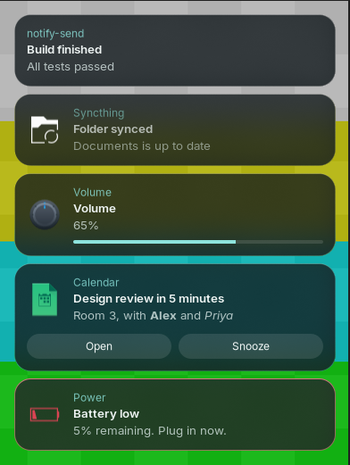
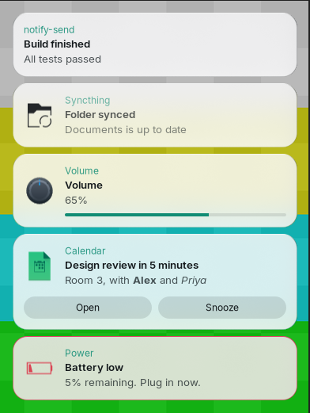
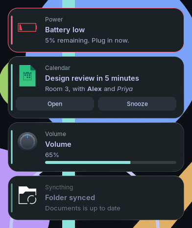

# Lucent

**A Wayland notification daemon that isn't there until you need it.**

[](https://github.com/CPT-Dawn/Lucent/actions/workflows/ci.yml)
[](https://aur.archlinux.org/packages/lucent)
[](Cargo.toml)
[](LICENSE)



- **Lightest at idle.** When nothing is on screen, Lucent is not running: no
  process, no memory, no CPU wakeups. D-Bus starts it for the next
  Notification, and it exits a few seconds after the last Popup closes. The
  other daemons in the [benchmark](#benchmark) stay resident at 8.7 to
  47 MiB.
- **Quick.** One thread, no toolkit, no async runtime. A Popup reaches the
  compositor about 7 ms after `notify-send` while Lucent is up, and about
  28 ms when it has to start first. Each Popup is drawn once and redrawn only
  when its content or hover state changes.
- **Good-looking by default.** *Midnight Bloom* is smoked glass with mint
  accents, made for compositor blur and still readable without it. Two more
  Presets, `light` and `opaque`, are one line away.

<table>
  <tr>
    <td></td>
    <td></td>
  </tr>
  <tr>
    <td align="center"><code>preset = "light"</code></td>
    <td align="center"><code>preset = "opaque"</code></td>
  </tr>
</table>

<sub>Captured with <code>grim</code> on Hyprland 0.57 using the layer rule from
<a href="#blur-and-animation">Blur and animation</a>, over a test pattern.
The Popups are the <code>notify-send</code> commands from
<a href="#usage">Usage</a>, with Breeze icons.</sub>

## Benchmark

Measured on 2026-10-29: Intel Core i7-13700HX, 31 GiB RAM, Linux
7.2.11-arch1-1, Hyprland 0.57.0, with `bench/benchmark.py --runs 10
--idle-seconds 60`. Latencies are medians.

| Daemon | Version | Binary size | Idle RSS | Idle wakeups | Peak RSS, 5 Popups | PSS, 5 Popups | Cold start | Warm |
|---|---|--:|--:|--:|--:|--:|--:|--:|
| **lucent** | 1.1.0 (be7e4e3)[^ver] | 1.8 MiB | **0 (not running)** | **0** | 24.5 MiB | 9.6 MiB | 28.0 ms | 6.7 ms |
| lucent (resident) | 1.1.0 (be7e4e3)[^ver] | 1.8 MiB | 9.1 MiB | 0 | 24.4 MiB | 9.6 MiB | 31.1 ms | 6.8 ms |
| mako | 1.11.0-1 | 91 KiB | 8.7 MiB | 0 | 22.9 MiB | 8.0 MiB | 25.7 ms | 6.1 ms |
| dunst | 1.13.2-3 | 207 KiB | 11.1 MiB | 63 | 30.5 MiB | 11.2 MiB | 14.8 ms[^dunst] | 9.8 ms |
| swaync | 0.12.6-1 | 615 KiB | 47.1 MiB | 0 | 307.4 MiB | 220.8 MiB | 231.2 ms | 43.5 ms |
| fnott | 1.8.0-1 | 187 KiB | 14.6 MiB | 0 | 20.6 MiB | 7.4 MiB | 31.3 ms | 5.8 ms |

[^ver]: A build of the `v2` branch at commit be7e4e3, before its version
    number was bumped.
[^dunst]: Too good to be true. dunst attaches a buffer to its 24×24 cursor
    surface as it starts, about 31 ms before it draws the Popup, and the
    benchmark takes that first commit for the Popup's first frame (a limit
    noted in [bench/README.md](bench/README.md)). Its real cold start is
    nearer 45 ms.

Reproduce it with [`bench/benchmark.py`](bench/README.md), which also explains
every column. In short: each daemon runs alone on a private D-Bus with its
packaged defaults; *idle* is a 60 s window with no Popup shown; *PSS* counts
shared library pages fairly; *cold start* is from `notify-send` to the first
frame handed to the compositor with no daemon process running, *warm* the
same with the daemon already up.

What the table says, plainly:

- **Idle** is where Lucent wins outright: it has exited, so there is nothing
  to measure. Kept resident (`idle_exit = false`), it sits with mako, at
  about 9 MiB.
- **While showing Popups**, fnott and mako use about 2 MiB less PSS than
  Lucent, and less peak RSS too. Lucent's binary is also the largest here.
- **Latency** is on par with mako and fnott, warm or cold. Cold start is the
  price of Idle exit: the first Notification after a quiet spell starts a
  process, which costs about 20 ms more than a warm one.

## Install

Arch Linux, from the AUR:

```sh
paru -S lucent
```

Other distributions: see [Building from source](#building-from-source).

## That's it

There is no autostart to set up: no `exec-once`, no systemd unit, no
`spawn-at-startup`. The package installs a D-Bus activation file, so the first
Notification starts Lucent, and Lucent exits again when it has nothing left to
show.

If another notification daemon is running, Lucent steps aside and logs which
one holds the bus name. See [Switching from mako, dunst or
swaync](#switching-from-mako-dunst-or-swaync).

## Usage

Anything that sends desktop notifications works, `notify-send` included:

```sh
notify-send "Build finished" "All tests passed"
notify-send -u low -a Syncthing -i folder-sync "Folder synced" "Documents is up to date"
notify-send -a Volume -i multimedia-volume-control -h int:value:65 "Volume" "65%"
notify-send -a Calendar -i x-office-calendar -A open=Open -A snooze=Snooze \
  "Design review in 5 minutes" "Room 3, with <b>Alex</b> and <i>Priya</i>"
notify-send -u critical -a Power -i battery-caution "Battery low" "5% remaining. Plug in now."
```

(`-A` makes `notify-send` wait and print the Action you click.)

- **Urgency:** critical Popups take the `critical` colour and never time out;
  low ones are faded so they don't compete for attention.
- **Actions** appear as buttons. **Progress** comes from the `value` hint.
  **Icons** come from your icon theme (PNG or SVG), or from an image the app
  sends (album art, avatars).
- **Mouse:** left-click runs the Default action and dismisses the Popup,
  middle-click dismisses it, right-click dismisses everything. Hovering a
  Popup pauses its timeout. Popups never take keyboard focus.
- **Stack and Queue:** up to five Popups are shown at once, newest nearest the
  anchor corner. The rest wait in the Queue, shown as "+N more", and appear as
  space frees up. A Notification that replaces another (a volume change, say)
  updates its Popup in place.

`lucent --default-config` prints the reference config; that is the only
command-line option.

## Configure

Lucent needs no config file. To change something, create
`~/.config/lucent/config.toml` and set only what you want; every key you
leave out keeps its default. Changes apply from the next Notification, since
Lucent reads the file each time it starts.

```sh
lucent --default-config   # every option, commented, with its default
```

The same file is installed at `/usr/share/doc/lucent/config.toml`. A typo
never silences your desktop: a broken file is logged and the defaults are
used, and unknown keys are logged and skipped.

### Presets

```toml
[theme]
preset = "light"   # "midnight-bloom" (default), "light" or "opaque"
```

| Preset | Look | Use it when |
|---|---|---|
| `midnight-bloom` | Dark smoked glass, mint accents | Your compositor blurs (it's still readable if not) |
| `light` | Paper-white glass, ink text | You have a light desktop |
| `opaque` | Midnight Bloom on solid ground | Your compositor has no blur |

### Theme overrides

Any Theme value can be set on top of the Preset:

```toml
[theme]
preset = "midnight-bloom"
font = "JetBrains Mono, monospace"
background = "rgba(20, 27, 31, 0.70)"
accent = "#FF9E64"
radius = 12
```

Colours are `"#RRGGBB"`, `"#RRGGBBAA"`, `"rgb(r, g, b)"` or
`"rgba(r, g, b, a)"`. The default font is `Inter Variable, Inter, sans-serif`
(Arch: `pacman -S inter-font`); the variable font keeps memory down, and
without Inter installed your `sans-serif` is used.

### Layout and behaviour

```toml
[general]
timeout = 8000             # ms; apps may ask for their own (honor_app_timeouts)
max_visible = 3
right_click = "dismiss"    # instead of "dismiss-all"

[layout]
anchor = "bottom-center"
width = 400
monitor = "DP-1"           # unset = the compositor's choice, normally the focused monitor

[layout.margin]
bottom = 48
```

### Rules

Rules restyle, or retime, the Notifications that match an app name and/or an
Urgency. Later Rules win.

```toml
[[rule]]
app_name = "Spotify"
timeout = 3000
theme = { summary_size = 13, accent = "#1DB954" }

[[rule]]
urgency = "critical"
theme = { critical = "#FF9E64", border_width = 2 }
```

### Staying resident

Idle exit trades a cold start on the first Notification after a quiet spell
for zero idle cost. To keep Lucent running instead:

```toml
[general]
idle_exit = false
```

## Blur and animation

Lucent draws a translucent Popup and leaves blur and enter/exit animation to
the compositor, so it never draws a frame it doesn't need. Every Popup is a
layer surface with the namespace `lucent`.

Blur needs no setup on compositors that offer the `ext-background-effect-v1`
protocol (Hyprland 0.57 does): Lucent asks for it behind every translucent
Popup, shaped to its rounded corners. Elsewhere, add the rule for your
compositor below. Opaque Themes never ask for blur.

| Compositor | Blur | Enter/exit animation |
| --- | --- | --- |
| Hyprland | yes | yes (`slide`, `popin`, `fade`) |
| SwayFX | yes | no: its `animation_duration_ms` covers windows only |
| Sway | no | no |
| niri | yes (26.04+) | no: niri's animations cover windows, workspaces and its own UI, and no `layer-rule` property animates a layer surface |

Lucent won't fake an animation on the compositors that lack one: drawing
its own frames would cost the wakeups it exists to avoid. On those, Popups
appear and disappear at once.

### Hyprland

Hyprland 0.55 and later (`hyprland.lua`):

```lua
hl.layer_rule({
    name         = "lucent",
    match        = { namespace = "^lucent$" },
    blur         = true,
    ignore_alpha = 0.1,
    animation    = "slide right",
})
```

Hyprland 0.53 and 0.54 (`hyprland.conf`):

```ini
layerrule {
    name = lucent
    match:namespace = ^lucent$
    blur = on
    ignore_alpha = 0.1
    animation = slide right
}
```

Blur itself must be on (`decoration.blur.enabled`, the default). Use
`slide left` for a left anchor, `slide top` or `slide bottom` for the centre
ones, or `popin 80%` or `fade`.

### Sway

Plain Sway has no blur. [SwayFX](https://github.com/WillPower3309/swayfx)
does:

```
blur enable
layer_effects "lucent" {
    blur enable;
    blur_ignore_transparent enable;
    corner_radius 20;
}
```

Neither animates layer surfaces: SwayFX's `animation_duration_ms` applies
to opening and closing windows only, and `layer_effects` has no animation
setting.

### niri

niri 26.04 and later:

```kdl
layer-rule {
    match namespace="^lucent$"
    geometry-corner-radius 20
    background-effect {
        blur true
    }
}
```

`geometry-corner-radius` rounds the blur to match the Popup; change it if
you change `radius`. niri has no layer-surface animation: none of its
`animations` (`window-open`, `window-close` and the rest) applies to layer
surfaces, and `layer-rule` has no animation property.

## Switching from mako, dunst or swaync

Only one daemon can own the notification bus name, and when several are
installed, which one D-Bus starts is not something you choose. So remove the
old one:

1. Remove whatever starts it: an `exec-once` line (Hyprland), an `exec` line
   (Sway) or a `spawn-at-startup` line (niri), and its systemd unit if you
   enabled one:

   ```sh
   systemctl --user disable --now mako.service   # or dunst / swaync / fnott
   ```

2. Uninstall it, which also removes its D-Bus activation file:

   ```sh
   paru -Rns mako   # or dunst / swaync / fnott
   ```

3. Stop it if it is still running (`pkill mako`), or log out and back in.

Then `notify-send hello` should show a Lucent Popup. Your old config is not
read; Lucent's options are in `lucent --default-config`.

## Troubleshooting and FAQ

**Nothing shows up.** Run Lucent in a terminal with debug logging and send a
Notification from another:

```sh
LUCENT_LOG=debug lucent
```

If it says `org.freedesktop.Notifications is already owned by mako (pid
1234)`, another daemon has the bus name; see
[Switching](#switching-from-mako-dunst-or-swaync). When D-Bus starts Lucent,
its log goes to your user journal: `journalctl --user -b | grep -i lucent`.

**No blur.** Blur is your compositor's job. Lucent asks for it where the
compositor offers `ext-background-effect-v1`; otherwise add the rule for your
compositor from [Blur and animation](#blur-and-animation). On Hyprland,
`hyprctl layers` should list a `lucent` layer while a Popup is showing. With
no blur available, `preset = "opaque"` looks intentional rather than
see-through.

**Popups are on the wrong monitor.** By default the compositor picks, which
is normally the focused monitor. Pin one with `[layout] monitor = "<name>"`,
using a name from `hyprctl monitors`, `swaymsg -t get_outputs` or
`niri msg outputs`. A name that matches nothing is logged.

**My config change did nothing.** Lucent reads its config when it starts. If
a Popup is still showing, it is still the old process: wait for it to exit
(about 5 s after the last Popup), then send another. Check the log for a
parse error.

**The first Notification is a little slower than the rest.** That is Idle
exit starting a fresh process; see the cold-start column in the
[benchmark](#benchmark). If you'd rather pay memory than latency, set
`idle_exit = false`.

**Upgrading from Lucent 1.x.** v2 is a clean break: v1 config keys such as
`background_color` or `timeout_seconds` are logged as unknown and ignored, so
start again from `lucent --default-config`. v1 installed its D-Bus file as
`org.freedesktop.Notifications.service`; the package replaces it with
`dev.cptdawn.Lucent.service`, but if you installed v1 by hand, delete the old
one (after checking it says `Exec=/usr/bin/lucent`):

```sh
sudo rm /usr/share/dbus-1/services/org.freedesktop.Notifications.service
```

**Is there a history, do-not-disturb or a control centre?** No. A process
that isn't running can't remember anything, and that is the point. If you
need those, swaync is excellent.

**GNOME or X11?** No. Lucent needs the layer-shell protocol, which wlroots
compositors, Hyprland, niri and KDE Plasma provide.

## Building from source

You need Rust 1.92 or newer and the development files for Cairo, Pango and
D-Bus (Debian and Ubuntu: `libcairo2-dev libpango1.0-dev libdbus-1-dev
pkg-config`).

```sh
git clone https://github.com/CPT-Dawn/Lucent.git
cd Lucent
cargo build --release --locked
sudo install -Dm755 target/release/lucent /usr/bin/lucent
sudo install -Dm644 dev.cptdawn.Lucent.service \
  /usr/share/dbus-1/services/dev.cptdawn.Lucent.service
```

The service file starts `/usr/bin/lucent`; edit its `Exec=` line if you
install elsewhere. Without it D-Bus can't start Lucent.

## Contributing

Issues and pull requests are welcome. Before opening a PR:

```sh
cargo fmt --all
cargo clippy --all-targets --features test-hooks -- -D warnings
cargo test
cargo test --features test-hooks
```

The `test-hooks` feature adds a D-Bus interface the bus tests use to click
Popups without a compositor. Never enable it in a build you install.

The vocabulary is in [GLOSSARY.md](GLOSSARY.md) and the big decisions are in
[docs/adr/](docs/adr/). Changes that cost idle memory or wakeups need a very
good reason.

## License

MIT. See [LICENSE](LICENSE).
