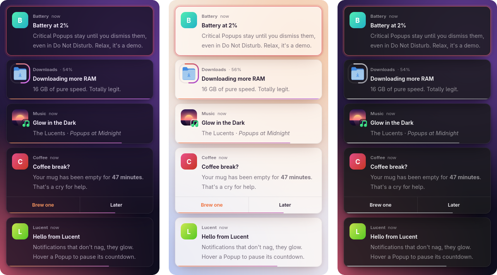
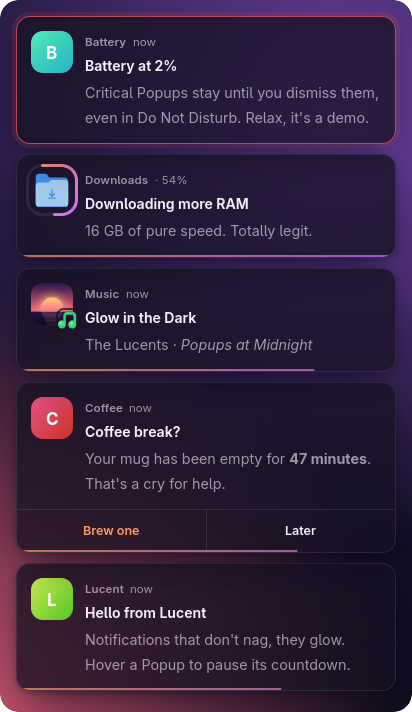
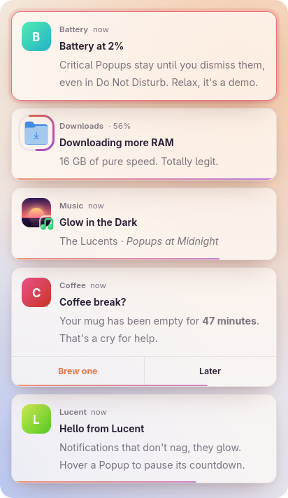
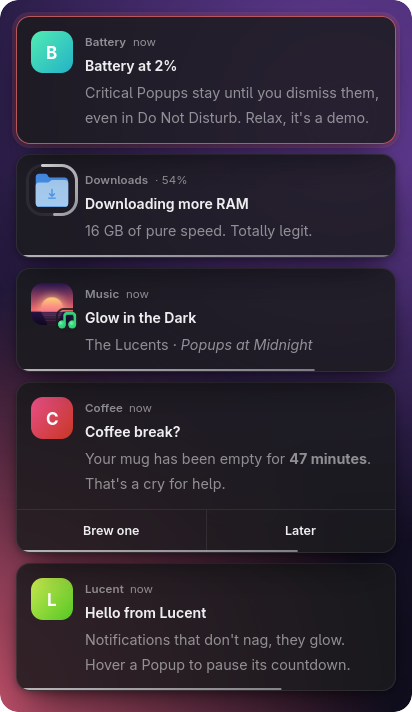
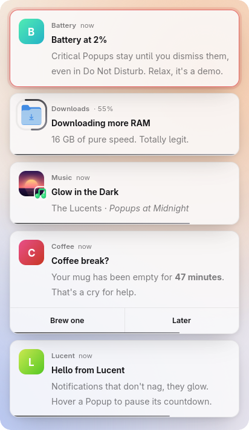

<div align="center">

# Lucent

**Notifications that don't nag, they glow.**<br>
A fast, gorgeous notification daemon for Wayland, written in Rust.

[](https://github.com/CPT-Dawn/Lucent/actions/workflows/ci.yml)
[](https://aur.archlinux.org/packages/lucent-bin)
[](LICENSE)



<sub>Real screenshots of <code>lucent demo</code> in Dawn, Daybreak and Graphite.</sub>

</div>

```sh
paru -S lucent-bin
```

That's it. There's nothing to add to your autostart: the first app that sends a Notification starts Lucent. To see it right away:

```sh
notify-send "Hello" "Is this thing on?"
lucent demo
```

`lucent demo` is a seven-second show with every kind of Popup Lucent can draw.

## Features

- **Looks great with zero config.** Glassy cards with the app icon, name, time, summary and body. Three built-in Themes, and the default follows your light or dark mode.
- **Everything apps send.** Icons, images and album art, Action buttons, bold, italic and links, and a progress ring traced around the icon.
- **Knows what matters.** Each Urgency gets its own timeout. Critical Popups glow red, pulse gently and stay until you dismiss them.
- **Calm by design.** A countdown line shows how long a Popup will stay, and hovering pauses it. Bursts stack up to a limit, and the rest wait behind a "+N more" pill. Reduced-motion settings are respected.
- **History.** Missed something? `lucent history` lists recent Notifications and `lucent restore` brings one back. History lives in memory only, so your 2FA codes never touch the disk.
- **Do Not Disturb.** `lucent dnd on` sends Notifications to History without a Popup. Critical ones still get through.
- **Rules.** Tame noisy apps: shorten Spotify, hide Discord's "is typing", make Slack Critical.
- **Live config.** Every key is optional, edits apply when you save, and `lucent check` points at typos with a suggested fix.
- **Bar-ready.** `lucent status --follow` streams JSON for Waybar without polling.
- **Mouse and keyboard.** Left-click runs the app's default Action (or dismisses), right-click dismisses, middle-click dismisses them all. `lucent dismiss` works from a keybind.

## Install

Lucent needs a Wayland compositor with layer-shell support, such as Hyprland, Sway, niri or river, with GTK 4.22 or newer and gtk4-layer-shell.

**Arch Linux (AUR):**

```sh
paru -S lucent-bin   # prebuilt, x86_64
paru -S lucent       # built from source, x86_64 and aarch64
```

**From source:**

```sh
git clone https://github.com/CPT-Dawn/Lucent.git
cd Lucent
cargo build --release --locked
sudo install -Dm755 target/release/lucent /usr/bin/lucent
sudo install -Dm644 org.freedesktop.Notifications.service \
  /usr/share/dbus-1/services/org.freedesktop.Notifications.service
```

The D-Bus service file lets D-Bus start Lucent on demand. It runs `/usr/bin/lucent`, so install the binary there or edit the file's `Exec=` line.

**Coming from mako, dunst or swaync?** Only one daemon can show Notifications at a time. If another one is running, `lucent` tells you which one and steps aside:

```text
mako is already showing your Notifications (pid 4242), so Lucent is standing aside.
To switch to Lucent, stop it and start Lucent:
    pkill -x mako && lucent
Then take mako out of your autostart (e.g. `exec-once` in hyprland.conf) so it stays stopped.
```

> [!NOTE]
> **GNOME isn't supported.** GNOME Shell has no layer-shell, and it shows Notifications itself.

## Configuration

On first start Lucent writes `~/.config/lucent/config.toml`. Every option is listed there with its default, commented out. Uncomment what you want to change and save: Lucent applies it immediately. If you save a broken config, Lucent keeps the last good one and tells you what's wrong. To check it yourself:

```sh
lucent check
```

### Themes

| Dawn | Daybreak | Graphite (dark) | Graphite (light) |
| :---: | :---: | :---: | :---: |
|  |  |  |  |

```toml
# auto (default): Dawn in dark mode, Daybreak in light mode.
# Graphite is a neutral grey Theme that follows light and dark too.
theme = "graphite"
```

### Placement, timeouts and `[look]`

```toml
theme = "graphite"

[popup]
position = "bottom-center"   # top or bottom, then left, center or right
width = 420
max_visible = 3              # the rest wait behind a "+N more" pill

[timeout]
normal = 8                   # seconds; low is 3 and critical is 0 (until dismissed)
                             # apps may set their own timeout, except for critical

[look]
accent = "#7dd3fc"           # replaces the Theme's gradient
opacity = 0.85               # scales the Theme's own translucency
radius = 10
font = "Inter"               # "" uses your system UI font
countdown = false            # hide the countdown line
```

The template has the rest: margins and gaps, `output` to pin Popups to one monitor, `icon_size`, the History `limit` and `allow_critical` for Do Not Disturb.

### `style.css`

For full control, create `~/.config/lucent/style.css`. It is applied on top of the Theme and reloads when you save it. Each Popup is a `.popup` (plus `.low` or `.critical`), with `.summary`, `.body`, `.app`, `.tile`, `.actions` and `.countdown` inside.

```css
/* Squarer cards with an accent edge */
.popup {
  border-radius: 6px;
  border-left: 3px solid #7dd3fc;
}

/* A bigger, bolder summary */
.popup .summary {
  font-size: 15px;
  font-weight: 800;
}

/* Low Urgency Popups whisper */
.popup.low {
  opacity: 0.7;
}

/* Critical ones get a red edge instead */
.popup.critical {
  border-left-color: #ff5370;
}
```

### Rules

Rules tame noisy apps. Each Rule starts with its own `[[rule]]` line and matches on `app` and/or `summary`, ignoring case, where `*` stands for any text. Rules are checked in order and the first match wins. A Rule can then set:

| Key | Effect |
| --- | --- |
| `timeout = 2` | Seconds this Popup stays (0 = until dismissed), even if the app asked for something else |
| `urgency = "critical"` | `low`, `normal` or `critical` |
| `hide = true` | No Popup, but it's still recorded in History |
| `history = false` | Keep it out of History |

```toml
# Spotify's track changes vanish after 2 seconds.
[[rule]]
app = "spotify"
timeout = 2

# Discord's "is typing" never pops up (it still lands in History).
[[rule]]
app = "discord"
summary = "*is typing*"
hide = true

# Slack is Critical: it stays until dismissed and gets through Do Not
# Disturb.
[[rule]]
app = "slack"
urgency = "critical"
```

Rules run before Do Not Disturb, so a Rule that makes an app Critical lets it through.

## Blur

Lucent's Popups are translucent. The frosted-glass blur behind them comes from your compositor, which matches Lucent by its layer-shell namespace, `lucent-notification`. Blur must also be turned on in your compositor's own settings.

**Hyprland** (`hyprland.lua`):

```lua
hl.layer_rule({
    name         = "lucent-blur",
    match        = { namespace = "^lucent-notification$" },
    blur         = true,
    ignore_alpha = 0.1,
})
```

**Hyprland** (`hyprland.conf`):

```ini
layerrule = blur on, ignore_alpha 0.1, match:namespace ^lucent-notification$
```

`ignore_alpha` keeps the blur on the cards themselves and off the transparent space around them.

**Sway** needs [SwayFX](https://github.com/WillPower3309/swayfx) for blur. In your Sway config:

```text
layer_effects "lucent-notification" {
    blur enable;
    blur_ignore_transparent enable;
}
```

**niri** 26.04 or newer:

```kdl
layer-rule {
    match namespace="^lucent-notification$"

    background-effect {
        blur true
    }
}
```

Popups look great without blur too. To let more of it through, lower `opacity` under `[look]`.

## Waybar

A bell with the History count. Click to toggle Do Not Disturb, right-click to bring back the latest Notification, middle-click to clear History.

```jsonc
"custom/lucent": {
  "exec": "lucent status --follow",
  "return-type": "json",
  "restart-interval": 5,
  "format": "{icon} {text}",
  "format-icons": {
    "none": "󰂜",
    "notification": "󰅸",
    "dnd-none": "󰪑",
    "dnd-notification": "󰪑"
  },
  "on-click": "lucent dnd toggle",
  "on-click-right": "lucent restore",
  "on-click-middle": "lucent clear"
}
```

Add `"custom/lucent"` to one of your `modules-*` lists. The icons are Nerd Font glyphs. `lucent status --follow` prints a line only when something changes, and it waits quietly if Lucent hasn't started yet. Style each state with `#custom-lucent.notification`, `#custom-lucent.dnd-none` and `#custom-lucent.dnd-notification`.

## Command line

| Command | What it does |
| --- | --- |
| `lucent` | Start the daemon. D-Bus also starts it for you when an app sends a Notification |
| `lucent demo` | Show off every kind of Popup in a short, playful demo |
| `lucent dismiss [--all]` | Dismiss the newest Popup, or all of them and everything in Overflow |
| `lucent history [--json]` | List History, newest first |
| `lucent restore [ID]` | Show a History entry again (default: the most recent) |
| `lucent clear` | Empty History |
| `lucent dnd [on\|off\|toggle]` | Switch Do Not Disturb, or show whether it's on. It's always off when Lucent starts |
| `lucent status [--follow]` | Print the History count and Do Not Disturb state as JSON |
| `lucent check [PATH]` | Validate the config and print its warnings and errors |
| `lucent reload` | Reload the config now (Lucent already reloads when you save) |

`lucent help <command>` tells you more. Two keybinds worth having in Hyprland:

```ini
bind = SUPER, N, exec, lucent dismiss
bind = SUPER SHIFT, N, exec, lucent dnd toggle
```

## Honest notes

**Memory.** Lucent is built on GTK 4, which buys correct text, icons, CSS Themes and smooth animation, and costs memory. Measured on Arch with Hyprland, GTK 4.24 and an NVIDIA GPU, `lucent` 2.0.0 release build:

| | RSS | PSS | Private |
| --- | ---: | ---: | ---: |
| Idle, before the first Popup | 176 MiB | 75 MiB | 17 MiB |
| After `lucent demo` | 316–330 MiB | 145–165 MiB | 71–90 MiB |

RSS counts every shared library in full, even those every other GTK app on your desktop also maps. PSS splits shared pages among the processes that use them, so it's the fairer total. Private is memory only Lucent uses. Most of the growth after the first Popups is GTK's GPU renderer, and it isn't handed back when the Popups leave. With `GSK_RENDERER=cairo` in Lucent's environment, PSS after the demo was 94 MiB (31 MiB private). Numbers vary with your GPU driver, icon theme and fonts.

**CPU.** An idle Lucent has no polling timers. It recorded zero context switches in 7 idle seconds.

**It stays running.** D-Bus starts Lucent on demand, and then it keeps running so History and Do Not Disturb survive between Notifications.

<details>
<summary>How the memory was measured</summary>

Each run used a private bus (`dbus-run-session`) and a scratch `XDG_CONFIG_HOME` on a live Hyprland session. Lucent was started directly, then `/proc/<pid>/smaps_rollup` was read (`Rss`, `Pss`, `Private_Dirty`) 3 and 10 seconds after start, 1 second after `lucent demo` finished (with the Critical Popup still showing), and again after `lucent dismiss --all`. The ranges cover three runs. Context switches were summed over `/proc/<pid>/task/*/status`.

</details>

## Upgrading from v1

Your v1 config still works. Lucent starts with its defaults and warns once per old key, naming its replacement. Run `lucent check` to see them all. The full key mapping is in the [v2.0.0 release notes](docs/release-notes/v2.0.0.md#upgrading-from-v1).

---

<sub>

**Contributing.** Issues and pull requests are welcome. Before you push, run `cargo fmt`, `cargo clippy --all-targets -- -D warnings` and `cargo test`. CI runs the same checks. Words like Popup, History and Rule have exact meanings in [GLOSSARY.md](GLOSSARY.md). Lucent is MIT licensed.

</sub>
