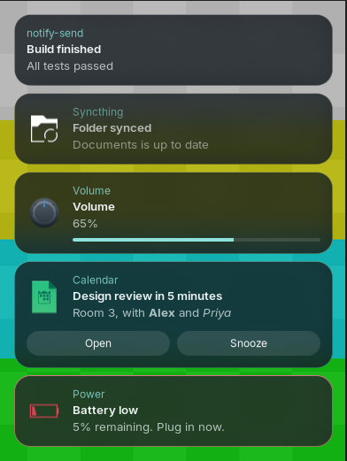
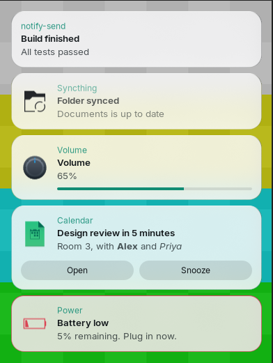
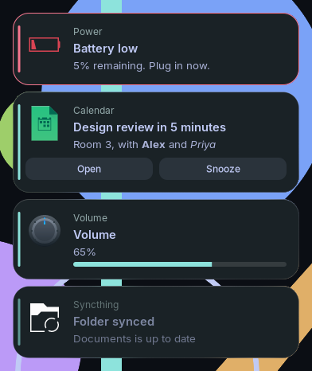

<div align="center">


# Lucent

**Wayland notifications that cost nothing at idle.**

A notification daemon and volume/brightness OSD for Hyprland, Sway, niri and other layer-shell compositors.<br>
D-Bus starts it for each Notification, and it exits when the last Popup closes.

[](https://github.com/CPT-Dawn/Lucent/releases/latest)
[](https://github.com/CPT-Dawn/Lucent/actions/workflows/ci.yml)
[](https://aur.archlinux.org/packages/lucent)
[](LICENSE)

[Install](#install) · [Quick start](#quick-start) · [Documentation](docs/README.md) · [Contributing](CONTRIBUTING.md)





<sub><code>midnight-bloom</code> (default) · <code>light</code> · <code>opaque</code></sub>

</div>

## Why Lucent

- **Zero idle footprint.** With nothing on screen, Lucent is not running: no memory, no wakeups. mako, dunst, swaync and fnott stay resident at 8.8 to 47 MiB ([benchmark](docs/benchmark.md)).
- **Quick.** One thread, no toolkit, no async runtime. A Popup reaches the compositor about 7 ms after `notify-send`, or 28 ms when Lucent has to start first.
- **No autostart to set up.** The package installs a D-Bus activation file, so there is no `exec-once`, systemd unit or `spawn-at-startup` line.
- **The OSD is built in.** `lucent osd volume up` changes the level and shows it, so SwayOSD, wob or avizo can go. Volume scripts written for dunst or mako work unchanged.
- **Good-looking by default.** Lucent asks the compositor for blur itself where it can (Hyprland 0.57 does) and draws text at your monitor's scale, fractional ones included.

## Install

Arch Linux, from the AUR:

```sh
paru -S lucent
```

<details>
<summary>Other ways to install</summary>

**Release tarball** (x86_64 and aarch64, glibc 2.39 or newer)

```sh
sha256sum -c lucent-*.tar.gz.sha256
tar xzf lucent-*.tar.gz && cd lucent-*/
sudo install -Dm755 lucent /usr/bin/lucent
sudo install -Dm644 dev.cptdawn.Lucent.service /usr/share/dbus-1/services/dev.cptdawn.Lucent.service
```

**From source** (needs Rust 1.92 or newer)

```sh
git clone https://github.com/CPT-Dawn/Lucent.git && cd Lucent
cargo build --release --locked
```

[Installation](docs/installation.md) has the steps after the build and the libraries each distribution needs.

</details>

Lucent needs Cairo, Pango and D-Bus. The OSD uses `wpctl` (WirePlumber) for volume and `brightnessctl` for brightness, if you have them.

Coming from mako, dunst or swaync? Uninstall it first: only one daemon can own the notification bus. See [Switching](docs/installation.md#switching-from-mako-dunst-or-swaync).

## Quick start

```sh
notify-send "Build finished" "All tests passed"
```

1. The Popup appears top-right. Hover it to pause its timeout.
2. Left-click runs its Default action, middle-click dismisses it, right-click dismisses all.
3. Bind a media key to `lucent osd volume up` and press it: the OSD shows the new level at the bottom of the screen.

There is no step 4. Five seconds after the last Popup closes, Lucent exits.

To change anything, `lucent --default-config` prints every option with its default.

## Documentation

| Guide | What it covers |
| --- | --- |
| [Installation](docs/installation.md) | Every install route, switching from another daemon, upgrading from 1.x |
| [Usage](docs/usage.md) | Urgency, Actions, the mouse, the Stack and Queue |
| [Configuration](docs/configuration.md) | Presets, Theme overrides, layout, Rules |
| [OSD](docs/osd.md) | Media key binds for Hyprland, Sway and niri |
| [Compositors](docs/compositors.md) | Blur and animation per compositor |
| [Troubleshooting](docs/troubleshooting.md) | The problems people hit, each with its fix |
| [Benchmark](docs/benchmark.md) | Lucent next to mako, dunst, swaync and fnott |
| [Changelog](CHANGELOG.md) | What changed in each release |

## Contributing

Issues and pull requests are welcome. [CONTRIBUTING.md](CONTRIBUTING.md) has the setup, the checks CI runs and how the screenshots are made.

## License

[MIT](LICENSE) © Swastik Patel
