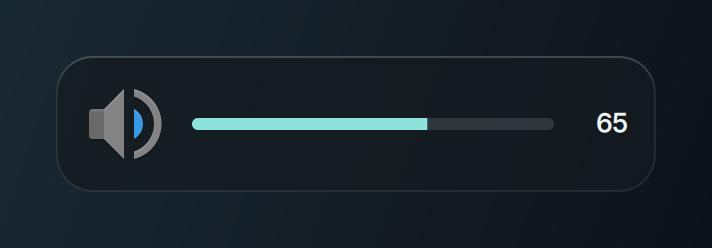

# OSD

Lucent's volume, microphone and brightness OSD: one compact bar at the bottom of the screen, apart from your notifications. It does the job of SwayOSD, wob or avizo with no second daemon to run. Like any Popup, the OSD starts Lucent and is gone a moment later.



## The command

Bind your media keys to `lucent osd`, which changes the level and shows it:

```sh
lucent osd volume up [STEP]      # also: down, mute, show
lucent osd mic mute              # also: up, down, show
lucent osd brightness up [STEP]  # also: down, show
```

`STEP` is a percentage, 5 by default. Volume goes through `wpctl` (WirePlumber), brightness through `brightnessctl`. Volume stops at 100% and brightness at 1%, so the screen never goes dark. A muted level is shown faded.

## Hyprland

Hyprland 0.55 and later (`hyprland.lua`):

```lua
local hw = { locked = true, repeating = true }
local function osd(args) return hl.dsp.exec_cmd("lucent osd " .. args) end

hl.bind("XF86AudioRaiseVolume",  osd("volume up"), hw)
hl.bind("XF86AudioLowerVolume",  osd("volume down"), hw)
hl.bind("XF86AudioMute",         osd("volume mute"), { locked = true })
hl.bind("XF86AudioMicMute",      osd("mic mute"), { locked = true })
hl.bind("XF86MonBrightnessUp",   osd("brightness up"), hw)
hl.bind("XF86MonBrightnessDown", osd("brightness down"), hw)
```

Hyprland 0.54 and earlier (`hyprland.conf`):

```ini
bindel = , XF86AudioRaiseVolume,  exec, lucent osd volume up
bindel = , XF86AudioLowerVolume,  exec, lucent osd volume down
bindl  = , XF86AudioMute,         exec, lucent osd volume mute
bindl  = , XF86AudioMicMute,      exec, lucent osd mic mute
bindel = , XF86MonBrightnessUp,   exec, lucent osd brightness up
bindel = , XF86MonBrightnessDown, exec, lucent osd brightness down
```

## Sway

```
bindsym --locked XF86AudioRaiseVolume  exec lucent osd volume up
bindsym --locked XF86AudioLowerVolume  exec lucent osd volume down
bindsym --locked XF86AudioMute         exec lucent osd volume mute
bindsym --locked XF86AudioMicMute      exec lucent osd mic mute
bindsym --locked XF86MonBrightnessUp   exec lucent osd brightness up
bindsym --locked XF86MonBrightnessDown exec lucent osd brightness down
```

## niri

```kdl
binds {
    XF86AudioRaiseVolume  allow-when-locked=true { spawn "lucent" "osd" "volume" "up"; }
    XF86AudioLowerVolume  allow-when-locked=true { spawn "lucent" "osd" "volume" "down"; }
    XF86AudioMute         allow-when-locked=true { spawn "lucent" "osd" "volume" "mute"; }
    XF86AudioMicMute      allow-when-locked=true { spawn "lucent" "osd" "mic" "mute"; }
    XF86MonBrightnessUp   allow-when-locked=true { spawn "lucent" "osd" "brightness" "up"; }
    XF86MonBrightnessDown allow-when-locked=true { spawn "lucent" "osd" "brightness" "down"; }
}
```

## Coming from SwayOSD

Replace `swayosd-client --output-volume raise` and friends with the lines above, then remove `swayosd-server` from your autostart.

## Your own scripts

Any Notification with a synchronous Tag and a `value` hint is shown as the OSD, so a script written for dunst or mako needs no change:

```sh
notify-send -h string:x-canonical-private-synchronous:volume \
  -h int:value:65 -i audio-volume-medium "Volume 65%"
```

## Configure it

The OSD takes the Theme and any matching Rule like other Popups do. A new OSD replaces the one already up. Place it, time it or turn it off in `[osd]`:

```toml
[osd]
anchor = "top-center"
timeout = 1000
width = 260
# enabled = false   # show these as ordinary Popups instead
```

The defaults are `bottom-center`, 1500 ms and a width of 300.

[Back to the README](../README.md)
